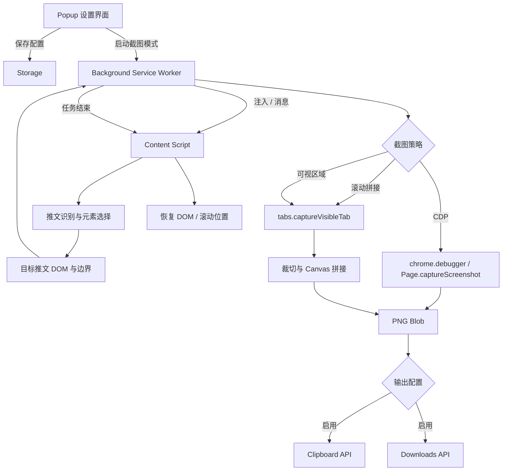

# X 推文截图工具开发方案

> 基于 WXT + TypeScript 的浏览器扩展
>
> 文档版本：1.0  
> 日期：2026-11-19  
> 首期平台：Chrome / Microsoft Edge（Manifest V3）

## 1. 项目概述

开发一个面向 X（`x.com` / `twitter.com`）的浏览器扩展。扩展识别页面中的推文 DOM，将指定推文按浏览器当前实际渲染结果截图，支持复制 PNG 到系统剪贴板，并可按设置同时下载到本地。

工具应保留真实网页渲染效果，不通过重新解析 CSS 并重绘页面来生成主截图。页面中由翻译扩展追加到推文 DOM 内的文字，应当随推文一起进入截图。用户还可以进入元素选择模式，临时屏蔽推文内不需要的 DOM 节点。

截图方式、是否复制到剪贴板、是否下载到本地，均可在扩展弹出层中配置。配置保存在本地扩展存储中。

### 1.1 产品目标

- 一键识别并截图完整推文，包括超出当前浏览器视口的内容。
- 尽可能保留浏览器当前真实渲染结果、字体、图片、布局及翻译插件插入的 DOM 内容。
- 允许临时隐藏推文中的指定 DOM 节点，不影响截图完成后的原页面。
- 支持多种截图策略，用户可以在弹出层中选择。
- 截图完成后可复制到剪贴板；也可根据用户配置下载 PNG 文件。
- 优先面向 Chrome / Edge，避免首期为了跨浏览器兼容牺牲截图质量。

### 1.2 非目标

首期不做以下功能：

- 自定义截图宽度。
- 自定义截图背景色。
- 多条推文自动合成长图或完整线程拼接。
- 截图图片编辑器、标注、马赛克和裁剪编辑。
- 图片云端上传、账号系统或截图历史云同步。
- 通过 html2canvas / html-to-image 重新绘制 DOM，作为默认截图引擎。

## 2. 功能需求

### 2.1 推文识别

- 支持 `x.com` 和 `twitter.com` 页面。
- 识别时间线、个人主页、搜索结果、单条推文详情页中的推文。
- 对每条推文提供明确的截图入口。建议首期采用鼠标悬停推文时显示轻量截图按钮，避免用户必须先猜测扩展将截取哪条推文。
- 支持识别推文正文、作者信息、时间、媒体内容、引用推文等当前推文卡片中的 DOM。
- 对 X 的动态渲染和局部刷新保持兼容；不得只依赖容易变化的 CSS class。
- 当无法识别目标推文时，向用户展示明确提示，而不是生成错误截图。

建议使用多级定位策略：

1. 优先使用页面中相对稳定的 `data-testid`、语义化 `article`、`role` 等属性。
2. 结合推文内的时间链接、作者链接等特征确认目标节点。
3. 将定位逻辑集中在 `tweet-detector.ts`，避免在业务代码中散落选择器。
4. 将 DOM 选择器视为可变适配层，并为 X 页面更新预留快速修复能力。

> 选择器仅作为实现策略，不应将某一个 `data-testid` 视为永久稳定的公开 API。

### 2.2 截图方式配置

弹出层提供「截图方式」下拉选择，配置持久化保存。首期提供以下四项：

| 模式 | 说明 | 是否覆盖视口外内容 | 推荐用途 |
|---|---|---:|---|
| 自动（推荐） | 优先使用 CDP 完整截图；不可用时回退滚动拼接 | 是 | 日常默认模式 |
| CDP 完整截图 | 通过 Chrome Debugger API 调用 CDP，一次截取目标推文区域 | 是 | 追求速度、保真度和画面连续性 |
| 滚动拼接 | 分段滚动页面并截图，再将图片拼接为完整推文 | 是 | 不使用 debugger 权限时的完整截图方案 |
| 当前可视区域 | 只截取目标推文当前可见的部分 | 否 | 快速截取当前屏幕中可见内容 |

#### A. 自动模式（默认）

执行顺序：

1. 检查当前标签页是否为受支持的 X 页面。
2. 检查是否已获得 `debugger` 可选权限。
3. 已获得权限时优先尝试 CDP 截图。
4. 若 CDP 不可用、连接失败或截图范围验证失败，则回退滚动拼接。
5. 若回退方案也失败，展示错误原因，不静默生成不完整图片。

自动模式应区分“CDP 不可用”和“目标推文本身无法识别”。目标节点识别失败时不应盲目使用整页截图作为替代。

#### B. CDP 完整截图

使用 `chrome.debugger` 连接当前标签页，并调用 Chrome DevTools Protocol：

- `Page.getLayoutMetrics`：读取页面布局尺寸等信息。
- `Page.captureScreenshot`：截取指定区域。
- 设置 `captureBeyondViewport: true`，允许捕获当前视口之外的页面区域。
- 使用目标推文元素的实际边界计算截图裁剪区域。
- 截图格式固定为 PNG。

该方案直接使用 Chromium 页面渲染结果，不需要重新绘制 DOM。推文内由翻译扩展插入的普通 DOM 节点，只要位于目标推文范围内且截图时已完成渲染，就会随截图一起保留。

实现注意事项：

- `getBoundingClientRect()` 返回的是视口坐标；需要结合页面滚动偏移和 CDP 布局指标换算截图坐标。
- 坐标换算、页面缩放、设备像素比和 `clip` 的坐标单位必须通过实际 Chrome 版本验证，不能仅凭普通视口截图经验推断。
- 需要正确处理目标元素的边框、圆角裁切、CSS transform、嵌套滚动容器等情况。
- `chrome.debugger` 应在 `try/finally` 中确保 detach；同时监听调试会话意外断开事件。
- 如果用户同时打开 DevTools，Chrome 可能中断扩展的 debugger 会话，应当提示并允许切换备用模式。
- 不要通过修改设备视口尺寸来强行扩大页面宽度；截图应以目标推文在当前页面中的真实布局为准。

#### C. 滚动拼接

使用 `chrome.tabs.captureVisibleTab()` 分段截取当前活动标签页，再通过 Canvas 拼接成一张 PNG。

建议流程：

1. 记录目标推文、其滚动祖先容器及原始滚动位置。
2. 计算目标推文在滚动容器中的完整范围。
3. 从推文顶部开始，按视口可见高度分段滚动，并保留适当重叠区域。
4. 每次滚动后等待页面布局稳定，再调用 `captureVisibleTab()`。
5. 根据目标推文当前可见区域裁切每一段截图。
6. 根据滚动偏移量将各片段拼接，避免重叠部分重复出现。
7. 拼接完成后恢复原始滚动位置，并恢复临时 DOM 修改。

风险和限制：

- `captureVisibleTab()` 只能截取当前活动标签页的可视区域，不能直接截取视口之外的内容。
- Chrome 对 `captureVisibleTab()` 有调用频率限制，拼接时必须串行并做节流。
- 页面滚动可能触发 X 的懒加载、虚拟列表更新或内容重排。
- 固定定位元素可能重复出现在多张截图中，因此必须严格裁切到目标推文区域。
- 拼接边缘可能因字体加载、图片加载或页面布局变化产生错位。
- 对动态内容应设置最大等待时间和最大分段数，避免无限等待。

该模式仍然基于浏览器实际渲染内容截图，Canvas 仅负责对浏览器截图结果进行拼接，不负责重新绘制网页 DOM。

#### D. 当前可视区域

使用 `chrome.tabs.captureVisibleTab()` 截取当前标签页，然后根据推文元素与视口的交集裁切图片。

- 仅输出当前屏幕能看到的推文部分。
- 不滚动页面，不尝试补齐推文剩余部分。
- 适合快速截取当前可见区域。
- 在 UI 中明确标注「仅当前可见部分」，避免用户误认为已经截取完整推文。

### 2.3 DOM 节点屏蔽

提供「选择要屏蔽的元素」交互模式。用户启动元素选择后，鼠标悬停时显示节点边框，点击节点即可将其加入本次截图的屏蔽列表。

功能要求：

- 仅允许选择当前目标推文内部的 DOM 节点，默认不允许选择整个推文根节点。
- 选择时排除扩展自己注入的按钮、工具栏和提示层。
- 支持取消单个屏蔽项、全部恢复和退出选择模式。
- 支持「本次截图临时屏蔽」与「保存为规则」两种使用方式。
- 屏蔽规则仅作用于目标推文，不得修改整站其他区域。
- 截图成功或失败后都必须恢复原 DOM 状态。

首期提供两种隐藏策略：

| 策略 | 实际效果 | 默认值 |
|---|---|---:|
| 隐藏并移除占位 | 使用 `display: none` 隐藏节点，同时移除其布局空间 | 是 |
| 隐藏但保留占位 | 使用 `visibility: hidden` 隐藏内容，保留原布局空间 | 否 |

实现要求：

- 不要直接调用 `element.remove()` 永久删除网页节点。
- 记录每个节点修改前的内联样式、相关属性和扩展自身添加的标记。
- 截图结束后精准恢复，不要简单地把 `display` 强制设置为空字符串，否则可能破坏网站原本的样式。
- 对被屏蔽节点使用节点引用管理，避免仅凭选择器恢复时误命中其他节点。
- 对保存的 CSS Selector 规则，应限制在目标推文子树内执行；不要保存依赖哈希 class 或页面随机生成 class 的规则。

### 2.4 翻译插件兼容

- 不读取翻译插件内部 API，不依赖某个具体翻译插件。
- 截图以当前 DOM 渲染结果为准。
- 只要翻译文本被插入目标推文 DOM 子树，且截图前已完成渲染，就应当包含在截图中。
- 若翻译结果通过独立 iframe、推文外部浮层或浏览器 UI 展示，则不保证自动包含；需要在兼容性测试中明确识别并记录。
- 截图前等待 DOM 短暂稳定，并等待 `document.fonts.ready`；图片加载设置合理超时，不因单张资源永远未加载而卡住。
- 不主动触发翻译操作，也不修改翻译插件内容。

### 2.5 输出配置

弹出层提供两个独立开关：

| 配置 | 默认值 | 说明 |
|---|---:|---|
| 复制到剪贴板 | 开启 | 截图成功后将 PNG 写入系统剪贴板，可直接粘贴到聊天软件 |
| 下载到本地 | 关闭 | 截图成功后下载 PNG 文件到浏览器默认下载目录 |

规则：

- 两个开关可同时开启。
- 两个开关都关闭时，禁用「开始截图」按钮，并提示至少启用一种输出方式。
- 如果复制失败但下载开启，应继续完成下载，并单独展示复制失败提示。
- 如果下载失败但复制成功，应保留剪贴板结果，并单独展示下载失败提示。
- 默认文件名格式：`x-post-{author}-{post-id}-{timestamp}.png`。
- 作者名、推文 ID 和时间不可用时，使用安全的时间戳文件名。
- 文件名需要移除路径分隔符和操作系统不允许的字符。
- 不提供文件名模板、截图宽度或背景色配置，避免首期设置过度复杂。

## 3. 用户交互设计

### 3.1 扩展弹出层

弹出层是设置入口和截图模式启动入口，建议布局如下：

```text
┌──────────────────────────────┐
│ X Post Capture               │
│ 当前页面：x.com               │
├──────────────────────────────┤
│ 截图方式                      │
│ [ 自动（推荐）             ▾ ] │
│                              │
│ 输出                          │
│ [✓] 复制到剪贴板              │
│ [ ] 下载到本地                │
│                              │
│ [进入截图模式]                │
├──────────────────────────────┤
│ 设置会自动保存                │
└──────────────────────────────┘
```

交互说明：

- 设置变化后自动保存到 `storage.local`。
- 弹出层显示当前标签页是否为受支持的 X 页面。
- 点击「进入截图模式」后，后台根据配置申请必要权限并向当前标签页注入或唤起 Content Script。
- 启动页面交互后弹出层关闭，由网页中的轻量工具栏承接后续操作。
- 如果当前不是 X 页面，禁用启动按钮并显示原因。

### 3.2 页面截图交互

建议采用页面内轻量工具栏，而不是让用户一直保持扩展 Popup 打开。Popup 在失去焦点时会关闭，不适合承载需要用户返回网页点击 DOM 的流程。

页面内工具栏建议包含：

- 选择推文：进入目标推文选择状态，点击一条推文。
- 屏蔽元素：进入元素选择模式。
- 已屏蔽数量：显示当前推文屏蔽的元素数。
- 取消屏蔽：恢复全部被屏蔽节点。
- 复制 / 截图：按当前输出配置执行截图。
- 取消：退出模式并恢复页面。

也可以在鼠标悬停的推文附近显示小型截图按钮，以缩短从选择到截图的操作路径。

### 3.3 状态提示

至少覆盖以下状态：

- 正在识别推文。
- 等待翻译或页面布局稳定。
- 正在截图。
- 正在拼接图片。
- 正在复制到剪贴板。
- 正在下载文件。
- 截图完成。
- 截图不完整或部分输出失败。
- 当前页面不支持。
- 需要授予权限。

## 4. 技术架构

### 4.1 技术栈

| 模块 | 技术 | 作用 |
|---|---|---|
| 扩展框架 | WXT | Manifest V3 扩展工程、构建和开发流程 |
| 语言 | TypeScript | 类型安全和模块化实现 |
| UI | React | Popup 和页面内工具栏 |
| 样式 | CSS Modules / Tailwind（二选一） | 扩展 UI 样式隔离和维护 |
| 本地配置 | WXT Storage / `storage.local` | 保存用户配置和过滤规则 |
| 页面交互 | Content Script | 推文识别、元素选择、DOM 临时修改 |
| 后台协调 | Background Service Worker | 权限管理、消息调度、截图任务协调 |
| 真实页面截图 | Chrome Debugger API + CDP | CDP 完整截图 |
| 备用截图 | `tabs.captureVisibleTab` | 可视区域截图和滚动拼接 |
| 图片处理 | Canvas / Blob | 拼接浏览器截图片段、转换图片数据 |
| 剪贴板 | Clipboard API | 写入 PNG 图片 |
| 本地下载 | Downloads API | 保存 PNG 文件 |
| 后台 DOM 能力 | Offscreen Document（按需） | 兼容旧版 Chrome 的剪贴板及 DOM 图片处理 |

### 4.2 模块关系



### 4.3 职责划分

**Popup**

- 读取和修改用户配置。
- 展示当前页面支持状态。
- 在用户点击启动时执行权限预检查。
- 向 Background 发送启动任务消息。

**Background Service Worker**

- 协调截图任务生命周期。
- 检查当前 tab 与权限。
- 使用 `chrome.debugger` 发送 CDP 命令。
- 调用 `tabs.captureVisibleTab()`。
- 负责 PNG 输出、剪贴板写入、下载调度。
- 收集错误并向页面 UI 返回执行状态。
- 确保 debugger session 正确关闭。

**Content Script**

- 识别 X 页面中的推文。
- 注入轻量工具栏和元素选择高亮层。
- 获取目标推文 DOM、滚动容器、坐标和必要元信息。
- 管理临时屏蔽节点。
- 执行截图前 DOM 稳定性检查。
- 在任务完成或异常时恢复页面状态。

**Offscreen Document（按需）**

- 在需要兼容 Chrome 156 及更早版本时，通过 `CLIPBOARD` reason 使用 Clipboard API。
- 可作为图片拼接与 Blob 处理的后台 DOM 环境。
- 使用前检查是否已存在 Offscreen Document，避免重复创建。
- Offscreen 页面只通过 Runtime 消息与 Service Worker 通信。

## 5. 配置与数据模型

建议使用版本化设置，方便未来升级配置结构。

```ts
export type CaptureMode =
  | 'auto'
  | 'cdp'
  | 'stitched'
  | 'viewport';

export interface CaptureSettings {
  version: 1;
  captureMode: CaptureMode;
  copyToClipboard: boolean;
  downloadToLocal: boolean;
}

export interface DomFilterRule {
  id: string;
  name: string;
  selector: string;
  enabled: boolean;
  hideMode: 'remove-space' | 'keep-space';
  createdAt: number;
}

export interface CaptureMetadata {
  tweetId?: string;
  author?: string;
  sourceUrl: string;
  capturedAt: number;
}
```

默认配置：

```ts
export const DEFAULT_SETTINGS: CaptureSettings = {
  version: 1,
  captureMode: 'auto',
  copyToClipboard: true,
  downloadToLocal: false,
};
```

建议：

- 用户设置和过滤规则分开存储，避免规则数据膨胀影响常用设置读取。
- `CaptureSettings` 必须有默认值和迁移逻辑。
- 不保存推文正文、图片或截图历史。
- 手动临时屏蔽状态只保存在当前页面任务内存中，任务结束后清空。
- 保存的过滤规则只保存用户主动创建的规则。

## 6. 权限设计

遵循最小权限原则。首期以 `activeTab` 和 `scripting` 在用户明确点击启动时访问当前页面，避免默认申请所有网站的长期访问权限。

建议 Manifest 权限规划：

| 权限 | 类型 | 用途 | 申请策略 |
|---|---|---|---|
| `storage` | 必需 | 保存设置与过滤规则 | 安装时声明 |
| `activeTab` | 必需 | 用户点击扩展后临时访问当前标签页 | 安装时声明 |
| `scripting` | 必需 | 在当前活动标签页注入 Content Script | 安装时声明 |
| `offscreen` | 按需 | 创建 Offscreen Document | 需要兼容时声明 |
| `debugger` | 可选 | CDP 完整截图 | 用户选择 CDP / 自动模式时按需申请 |
| `clipboardWrite` | 可选 | 写入 PNG 剪贴板 | 首次复制前按需申请，或根据浏览器策略声明 |
| `downloads` | 可选 | 通过 Downloads API 下载文件 | 用户开启下载选项时按需申请 |

注意事项：

- `debugger` 权限的权限警告较强，Chrome 会提示访问页面调试后端及读取、更改网站数据的能力。应在 UI 中说明它仅用于当前标签页截图，并在用户选择 CDP 模式或自动模式首次运行时请求。
- 使用 `chrome.permissions.request()` 申请可选权限时，必须由明确的用户手势触发。
- 用户拒绝 `debugger` 后，自动模式转为滚动拼接；手动 CDP 模式则提示需要权限，并提供前往权限管理的入口。
- 用户拒绝 `downloads` 后仍可复制剪贴板，不应阻塞其他输出。
- 对 `clipboardWrite` 的处理应按 Chrome 版本验证。Chrome 157 起扩展 Service Worker 在拥有该权限时可以直接使用 `navigator.clipboard` 写入；更早版本可使用 Offscreen Document 的 `CLIPBOARD` reason。建议将剪贴板能力封装成适配层，避免业务逻辑依赖浏览器版本细节。
- 如果后续要支持 Firefox，需要单独验证 Debugger API 和剪贴板差异；首期不承诺 Firefox 的 CDP 完整截图能力。

## 7. 核心流程设计

### 7.1 启动流程

1. 用户打开扩展 Popup。
2. Popup 读取本地设置，并检查当前 tab URL。
3. 用户选择截图方式和输出选项。
4. 用户点击「进入截图模式」。
5. Popup 根据当前截图方式和输出配置申请尚未授予的可选权限。
6. Background 获取当前 tab 信息，并向页面注入或唤起 Content Script。
7. Popup 关闭，页面进入截图交互状态。
8. 用户选择目标推文。

### 7.2 截图流程

1. Content Script 确认目标推文节点。
2. 应用用户选择的临时屏蔽项和已启用过滤规则。
3. 等待推文 DOM 短暂稳定，等待字体就绪，并对媒体资源设置加载超时。
4. 获取目标节点范围、页面滚动状态和推文元数据。
5. 根据 `captureMode` 选择截图引擎。
6. 生成 PNG Blob。
7. 根据输出选项分别执行剪贴板复制和本地下载。
8. 将各输出通道结果返回 UI。
9. 恢复 DOM 样式、页面滚动位置、事件监听器和工具栏状态。
10. 展示完成状态。

### 7.3 异常恢复

截图任务必须采用统一清理入口：

- 无论截图成功、失败、用户取消还是 debugger 被断开，都必须恢复被隐藏的 DOM。
- 滚动拼接必须恢复原始的 `scrollTop` / `scrollLeft`，必要时同时恢复窗口滚动位置。
- 删除扩展注入的高亮 class、覆盖层、临时属性和事件监听器。
- 避免在 `finally` 之外散落 DOM 恢复逻辑。
- 单独记录截图、剪贴板、下载三个阶段的状态，允许其中一个输出失败而另一个成功。

## 8. 文件结构建议

```text
x-post-capture/
├── entrypoints/
│   ├── background.ts
│   ├── popup/
│   │   ├── index.html
│   │   ├── main.tsx
│   │   └── App.tsx
│   ├── content.ts
│   └── offscreen/
│       ├── index.html
│       └── main.ts
├── components/
│   ├── CaptureModeSelect.tsx
│   ├── OutputSettings.tsx
│   ├── PageCaptureToolbar.tsx
│   ├── TweetHoverButton.tsx
│   └── ElementPickerOverlay.tsx
├── modules/
│   ├── tweet/
│   │   ├── tweet-detector.ts
│   │   ├── tweet-metadata.ts
│   │   └── tweet-observer.ts
│   ├── filter/
│   │   ├── dom-filter.ts
│   │   ├── element-picker.ts
│   │   └── filter-rules.ts
│   ├── capture/
│   │   ├── capture-manager.ts
│   │   ├── cdp-capture.ts
│   │   ├── stitched-capture.ts
│   │   ├── viewport-capture.ts
│   │   ├── capture-coordinates.ts
│   │   └── image-stitcher.ts
│   ├── output/
│   │   ├── clipboard.ts
│   │   ├── download.ts
│   │   └── file-name.ts
│   └── page/
│       ├── dom-stability.ts
│       ├── scroll-manager.ts
│       └── cleanup.ts
├── services/
│   ├── message-router.ts
│   ├── permission-manager.ts
│   └── task-manager.ts
├── stores/
│   └── settings.ts
├── types/
│   ├── settings.ts
│   ├── capture.ts
│   └── messages.ts
├── utils/
│   ├── blob.ts
│   ├── timeout.ts
│   └── logger.ts
├── public/
├── wxt.config.ts
├── package.json
└── tsconfig.json
```

目录可根据实际复杂度调整，重点是将推文 DOM 适配、截图引擎、输出通道和 UI 解耦。

## 9. 消息协议建议

Popup、Background、Content Script 和 Offscreen Document 之间使用明确的消息类型，不直接共享复杂运行时状态。

```ts
export type ExtensionMessage =
  | { type: 'START_CAPTURE_MODE'; settings: CaptureSettings }
  | { type: 'TWEET_SELECTED'; tweetKey: string }
  | { type: 'REQUEST_CAPTURE'; tweetKey: string }
  | { type: 'CAPTURE_PROGRESS'; stage: string; progress?: number }
  | { type: 'CAPTURE_RESULT'; blob?: Blob; metadata?: CaptureMetadata }
  | { type: 'CAPTURE_ERROR'; code: string; message: string }
  | { type: 'CANCEL_CAPTURE' }
  | { type: 'RESTORE_PAGE_STATE' };
```

实际跨上下文传输时，需要确认 WXT / 浏览器消息通道支持的数据类型。若 Blob 不适合直接经由消息传输，可使用 ArrayBuffer 或扩展内临时对象 URL，并限制大图片的复制次数，避免重复 Base64 编码造成内存开销。

## 10. 测试方案

### 10.1 推文类型

- 普通短文本推文。
- 超长文本推文，内容高度明显超过浏览器视口。
- 含多张图片的推文。
- 含视频封面或 GIF 的推文。
- 含引用推文的推文。
- 含翻译插件逐行追加内容的推文。
- 含「显示更多」折叠文本的推文。
- 位于时间线、搜索结果、用户主页和推文详情页的推文。

### 10.2 截图方式

- CDP 在推文完整位于视口内时截图。
- CDP 在推文部分超出视口时截图。
- CDP 在推文完全或大部分位于视口外时截图。
- 页面处于非 100% 缩放时截图。
- 页面存在嵌套滚动容器时截图。
- DevTools 打开导致 debugger 会话冲突时的错误处理。
- debugger 权限被拒绝时自动模式是否正确回退。
- 滚动拼接在长推文、懒加载图片和页面虚拟滚动下的完整性。
- 可视区域模式是否只输出视口交集，并正确提示结果不完整。

### 10.3 DOM 屏蔽

- 隐藏正文内某个节点。
- 隐藏翻译段落。
- 隐藏媒体区或推文附加区域。
- 使用两种隐藏策略时布局是否符合预期。
- 截图失败、用户取消、标签页切换后是否恢复原 DOM。
- 保存的规则是否只作用于推文内部。
- X 动态刷新后旧节点引用是否被正确清理。

### 10.4 输出

- 仅复制剪贴板。
- 仅下载本地。
- 同时复制和下载。
- 复制失败但下载成功。
- 下载失败但复制成功。
- 两种输出都关闭时截图操作是否被禁用。
- PNG 粘贴到 QQ、微信、Discord、Slack 等目标聊天工具的兼容性。
- 文件名在不同操作系统上的合法性。

### 10.5 验收标准

- 能够稳定识别常见 X 页面中的目标推文。
- 对普通长推文，CDP 模式生成的图片完整覆盖推文边界，不裁掉正文或媒体。
- 翻译插件追加在推文 DOM 子树中的文字能够出现在截图中。
- DOM 屏蔽只在截图任务期间生效，完成后恢复页面。
- 自动模式在 debugger 不可用时能回退滚动拼接。
- 可视区域模式明确呈现为局部截图，不误报为完整推文。
- 剪贴板与下载选项互相独立，可同时开启。
- 截图异常不会造成网页滚动位置、隐藏节点或扩展工具栏残留。
- 不申请与截图无关的网站权限，不上传用户推文内容或截图。

## 11. 开发阶段与交付物

| 阶段 | 主要工作 | 交付物 |
|---|---|---|
| P0：技术验证 | WXT MV3 工程；验证 X 推文识别；验证 CDP 截取视口外 DOM；验证坐标换算 | 技术验证分支、截图样例、风险记录 |
| P1：最小可用版 | Popup 配置；CDP 截图；剪贴板复制；本地下载 | 可安装的 Chrome / Edge 扩展 |
| P2：备用截图 | 滚动拼接；当前可视区域模式；自动回退逻辑 | 三种截图执行路径及自动模式 |
| P3：DOM 编辑 | 页面内工具栏；元素选择；临时屏蔽；过滤规则持久化 | DOM 屏蔽功能 |
| P4：稳定性 | 动态页面、翻译插件、长图、权限拒绝、异常恢复测试 | 测试记录、修复清单、发布构建 |

建议 P0 阶段优先做一个最小实验：在真实 X 页面中选定一条长推文，Content Script 读取元素边界，Background 使用 `chrome.debugger` 调用 `Page.captureScreenshot`，验证 `captureBeyondViewport` 和 `clip` 能否精确输出完整推文。坐标正确性得到验证后，再铺开 UI 和配置功能。

## 12. 风险与应对

| 风险 | 影响 | 应对方案 |
|---|---|---|
| X 页面 DOM 改版 | 无法识别推文或选错节点 | 集中管理选择器、设置多级识别策略、维护回归样例 |
| CDP 权限提示过强 | 用户不愿授权 | `debugger` 设为可选权限，首次选择 CDP 时解释用途；提供拼接模式 |
| CDP 坐标换算错误 | 截图偏移、裁切不完整 | P0 验证滚动偏移、缩放、DPR、嵌套滚动和 clip 坐标 |
| 长图尺寸过大 | 内存峰值高、编码失败 | 设定合理像素面积上限；捕获尺寸异常并提示；必要时考虑分块处理 |
| 页面动态加载 | 截图缺图或布局跳动 | 等待 DOM 稳定、图片加载超时、滚动前后重新校验元素范围 |
| X 虚拟列表 | 拼接期间目标节点被卸载 | 滚动拼接时持续验证节点身份；无法保证时提示改用 CDP |
| 翻译内容位于推文 DOM 外 | 截图不包含翻译 | 明确兼容边界；后续按具体翻译插件提供可选适配器 |
| debugger 与 DevTools 冲突 | CDP 会话中断 | 监听 `onDetach`；清理并回退拼接模式 |
| 剪贴板权限或浏览器差异 | 复制失败 | Clipboard Adapter + Offscreen 兼容路径；单独展示复制状态 |
| 屏蔽节点未恢复 | 破坏网页显示 | 统一 `finally` 清理、节点引用快照、异常恢复测试 |

## 13. 安全与隐私

- 所有截图和图片处理在本地浏览器内完成。
- 不上传推文文本、页面 HTML、图片或截图。
- 不读取 X 登录 Cookie、认证令牌或私信内容。
- 不申请所有网站的永久访问权限；通过用户主动操作访问当前标签页。
- `debugger`、`downloads`、`clipboardWrite` 尽可能采用可选权限并在具体功能触发时申请。
- 不修改 X 的业务数据，也不向页面发送推文发布、点赞、转发等操作。
- 日志中不得记录完整推文正文；错误日志只保留阶段、错误码和必要的技术信息。

## 14. 参考资料

以下为实现时应优先查阅的官方资料。CDP 属于随 Chromium 演进的调试协议，开发时应针对目标 Chrome / Edge 版本进行实测。

- [WXT：Manifest 配置](https://wxt.dev/guide/essentials/config/manifest)
- [WXT：Entrypoints](https://wxt.dev/guide/essentials/entrypoints)
- [WXT：Storage](https://wxt.dev/guide/essentials/storage)
- [Chrome Extensions：chrome.debugger](https://developer.chrome.com/docs/extensions/reference/api/debugger)
- [Chrome DevTools Protocol：Page.captureScreenshot](https://chromedevtools.github.io/devtools-protocol/tot/Page/#method-captureScreenshot)
- [Chrome Extensions：chrome.tabs.captureVisibleTab](https://developer.chrome.com/docs/extensions/reference/api/tabs#method-captureVisibleTab)
- [Chrome Extensions：Offscreen API](https://developer.chrome.com/docs/extensions/reference/api/offscreen)
- [Chrome Extensions：Downloads API](https://developer.chrome.com/docs/extensions/reference/api/downloads)
- [Chrome Extensions：Permissions](https://developer.chrome.com/docs/extensions/reference/permissions-list)
- [MDN：Clipboard API in WebExtensions](https://developer.mozilla.org/en-US/docs/Mozilla/Add-ons/WebExtensions/Interact_with_the_clipboard)

---

## 附：首期建议默认值

| 配置项 | 默认值 |
|---|---|
| 截图方式 | 自动（推荐） |
| 复制到剪贴板 | 开启 |
| 下载到本地 | 关闭 |
| 临时屏蔽策略 | 隐藏并移除占位（`display: none`） |
| 自动等待 DOM 稳定 | 开启 |
| 目标页面 | `x.com`、`twitter.com` |
| 图片格式 | PNG |
| 自定义截图宽度 | 不提供 |
| 自定义背景色 | 不提供 |
